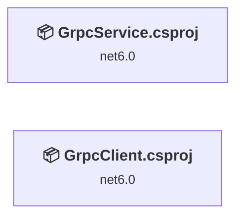
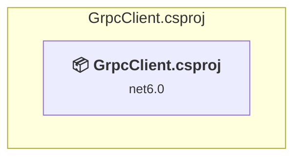
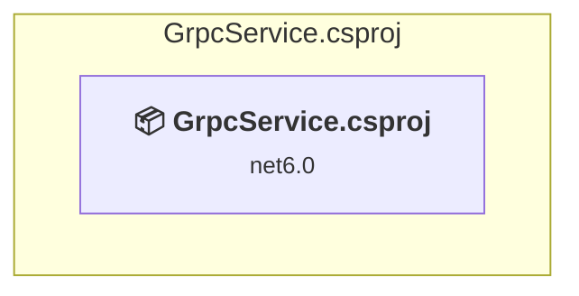

# Projects and dependencies analysis

This document provides a comprehensive overview of the projects and their dependencies in the context of upgrading to .NETCoreApp,Version=v10.0.

## Table of Contents

- [Executive Summary](#executive-Summary)
  - [Highlevel Metrics](#highlevel-metrics)
  - [Projects Compatibility](#projects-compatibility)
  - [Package Compatibility](#package-compatibility)
  - [API Compatibility](#api-compatibility)
  - [Binding Redirect Configuration](#binding-redirect-configuration)
- [Aggregate NuGet packages details](#aggregate-nuget-packages-details)
- [Top API Migration Challenges](#top-api-migration-challenges)
  - [Technologies and Features](#technologies-and-features)
  - [Most Frequent API Issues](#most-frequent-api-issues)
- [Projects Relationship Graph](#projects-relationship-graph)
- [Project Details](#project-details)

  - [GrpcClient\GrpcClient.csproj](#grpcclientgrpcclientcsproj)
  - [GrpcService\GrpcService.csproj](#grpcservicegrpcservicecsproj)

## Executive Summary

### Highlevel Metrics

| Metric | Count | Status |
| :--- | :---: | :--- |
| Total Projects | 2 | All require upgrade |
| Total NuGet Packages | 22 | All compatible |
| Total Code Files | 3 |  |
| Total Code Files with Incidents | 2 |  |
| Total Lines of Code | 153 |  |
| Total Number of Issues | 2 |  |
| Estimated LOC to modify | 0+ | at least 0.0% of codebase |

### Projects Compatibility

| Project | Target Framework | Difficulty | Package Issues | API Issues | Binding Issues | Est. LOC Impact | Description |
| :--- | :---: | :---: | :---: | :---: | :---: | :---: | :--- |
| [GrpcClient\GrpcClient.csproj](#grpcclientgrpcclientcsproj) | net6.0 | 🟢 Low | 0 | 0 | 0 |  | DotNetCoreApp, Sdk Style = True |
| [GrpcService\GrpcService.csproj](#grpcservicegrpcservicecsproj) | net6.0 | 🟢 Low | 0 | 0 | 0 |  | AspNetCore, Sdk Style = True |

### Package Compatibility

| Status | Count | Percentage |
| :--- | :---: | :---: |
| ✅ Compatible | 22 | 100.0% |
| ⚠️ Incompatible | 0 | 0.0% |
| 🔄 Upgrade Recommended | 0 | 0.0% |
| ***Total NuGet Packages*** | ***22*** | ***100%*** |

### API Compatibility

| Category | Count | Impact |
| :--- | :---: | :--- |
| 🔴 Binary Incompatible | 0 | High - Require code changes |
| 🟡 Source Incompatible | 0 | Medium - Needs re-compilation and potential conflicting API error fixing |
| 🔵 Behavioral change | 0 | Low - Behavioral changes that may require testing at runtime |
| ✅ Compatible | 1049 |  |
| ***Total APIs Analyzed*** | ***1049*** |  |

## Aggregate NuGet packages details

| Package | Current Version | Suggested Version | Projects | Description |
| :--- | :---: | :---: | :--- | :--- |
| Google.Protobuf | 3.18.0 |  | [GrpcService.csproj](#grpcservicegrpcservicecsproj) | ✅Compatible |
| Google.Protobuf | 3.21.12 |  | [GrpcClient.csproj](#grpcclientgrpcclientcsproj) | ✅Compatible |
| Grpc.AspNetCore | 2.40.0 |  | [GrpcService.csproj](#grpcservicegrpcservicecsproj) | ✅Compatible |
| Grpc.AspNetCore.Server | 2.40.0 |  | [GrpcService.csproj](#grpcservicegrpcservicecsproj) | ✅Compatible |
| Grpc.AspNetCore.Server.ClientFactory | 2.40.0 |  | [GrpcService.csproj](#grpcservicegrpcservicecsproj) | ✅Compatible |
| Grpc.Core.Api | 2.50.0 |  | [GrpcClient.csproj](#grpcclientgrpcclientcsproj) [GrpcService.csproj](#grpcservicegrpcservicecsproj) | ✅Compatible |
| Grpc.Net.Client | 2.50.0 |  | [GrpcClient.csproj](#grpcclientgrpcclientcsproj) [GrpcService.csproj](#grpcservicegrpcservicecsproj) | ✅Compatible |
| Grpc.Net.ClientFactory | 2.50.0 |  | [GrpcService.csproj](#grpcservicegrpcservicecsproj) | ✅Compatible |
| Grpc.Net.Common | 2.50.0 |  | [GrpcClient.csproj](#grpcclientgrpcclientcsproj) [GrpcService.csproj](#grpcservicegrpcservicecsproj) | ✅Compatible |
| Grpc.Tools | 2.40.0 |  | [GrpcService.csproj](#grpcservicegrpcservicecsproj) | ✅Compatible |
| Grpc.Tools | 2.51.0 |  | [GrpcClient.csproj](#grpcclientgrpcclientcsproj) | ✅Compatible |
| Microsoft.Extensions.Configuration | 3.0.3 |  | [GrpcService.csproj](#grpcservicegrpcservicecsproj) | ✅Compatible |
| Microsoft.Extensions.Configuration.Abstractions | 3.0.3 |  | [GrpcService.csproj](#grpcservicegrpcservicecsproj) | ✅Compatible |
| Microsoft.Extensions.Configuration.Binder | 3.0.3 |  | [GrpcService.csproj](#grpcservicegrpcservicecsproj) | ✅Compatible |
| Microsoft.Extensions.DependencyInjection | 3.0.3 |  | [GrpcService.csproj](#grpcservicegrpcservicecsproj) | ✅Compatible |
| Microsoft.Extensions.DependencyInjection.Abstractions | 3.0.3 |  | [GrpcService.csproj](#grpcservicegrpcservicecsproj) | ✅Compatible |
| Microsoft.Extensions.Http | 3.0.3 |  | [GrpcService.csproj](#grpcservicegrpcservicecsproj) | ✅Compatible |
| Microsoft.Extensions.Logging | 3.0.3 |  | [GrpcService.csproj](#grpcservicegrpcservicecsproj) | ✅Compatible |
| Microsoft.Extensions.Logging.Abstractions | 3.0.3 |  | [GrpcClient.csproj](#grpcclientgrpcclientcsproj) [GrpcService.csproj](#grpcservicegrpcservicecsproj) | ✅Compatible |
| Microsoft.Extensions.Options | 3.0.3 |  | [GrpcService.csproj](#grpcservicegrpcservicecsproj) | ✅Compatible |
| Microsoft.Extensions.Primitives | 3.0.3 |  | [GrpcService.csproj](#grpcservicegrpcservicecsproj) | ✅Compatible |
| System.Memory | 4.5.3 |  | [GrpcClient.csproj](#grpcclientgrpcclientcsproj) [GrpcService.csproj](#grpcservicegrpcservicecsproj) | ✅Compatible |

## Top API Migration Challenges

### Technologies and Features

| Technology | Issues | Percentage | Migration Path |
| :--- | :---: | :---: | :--- |

### Most Frequent API Issues

| API | Count | Percentage | Category |
| :--- | :---: | :---: | :--- |

## Projects Relationship Graph

Legend:
📦 SDK-style project
⚙️ Classic project

## Project Details

### GrpcClient\GrpcClient.csproj

#### Project Info

- **Current Target Framework:** net6.0
- **Proposed Target Framework:** net10.0
- **SDK-style**: True
- **Project Kind:** DotNetCoreApp
- **Dependencies**: 0
- **Dependants**: 0
- **Number of Files**: 1
- **Number of Files with Incidents**: 1
- **Lines of Code**: 77
- **Estimated LOC to modify**: 0+ (at least 0.0% of the project)

#### Dependency Graph

Legend:
📦 SDK-style project
⚙️ Classic project

### API Compatibility

| Category | Count | Impact |
| :--- | :---: | :--- |
| 🔴 Binary Incompatible | 0 | High - Require code changes |
| 🟡 Source Incompatible | 0 | Medium - Needs re-compilation and potential conflicting API error fixing |
| 🔵 Behavioral change | 0 | Low - Behavioral changes that may require testing at runtime |
| ✅ Compatible | 521 |  |
| ***Total APIs Analyzed*** | ***521*** |  |

### GrpcService\GrpcService.csproj

#### Project Info

- **Current Target Framework:** net6.0
- **Proposed Target Framework:** net10.0
- **SDK-style**: True
- **Project Kind:** AspNetCore
- **Dependencies**: 0
- **Dependants**: 0
- **Number of Files**: 4
- **Number of Files with Incidents**: 1
- **Lines of Code**: 76
- **Estimated LOC to modify**: 0+ (at least 0.0% of the project)

#### Dependency Graph

Legend:
📦 SDK-style project
⚙️ Classic project

### API Compatibility

| Category | Count | Impact |
| :--- | :---: | :--- |
| 🔴 Binary Incompatible | 0 | High - Require code changes |
| 🟡 Source Incompatible | 0 | Medium - Needs re-compilation and potential conflicting API error fixing |
| 🔵 Behavioral change | 0 | Low - Behavioral changes that may require testing at runtime |
| ✅ Compatible | 528 |  |
| ***Total APIs Analyzed*** | ***528*** |  |

